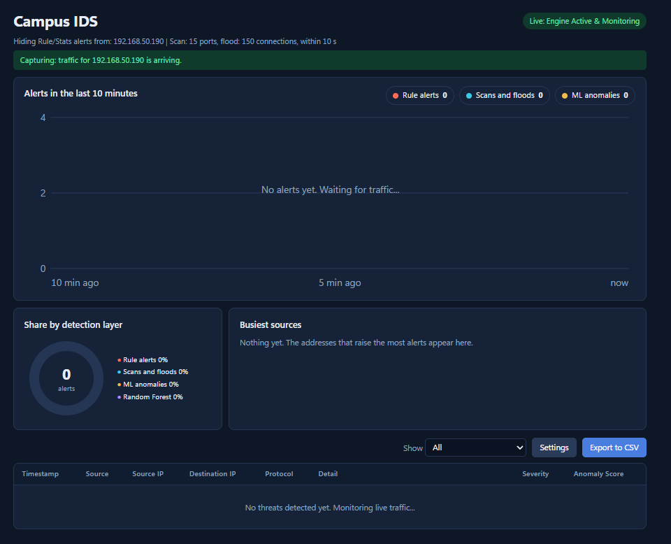
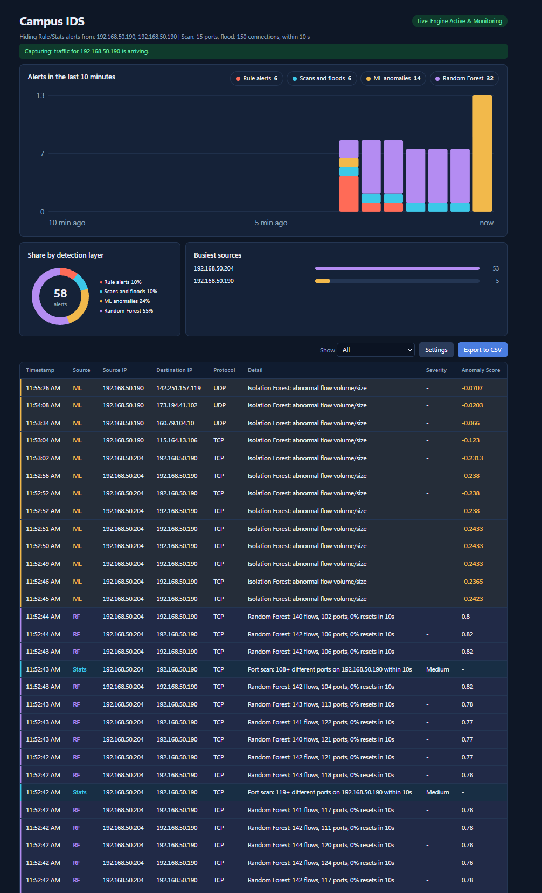
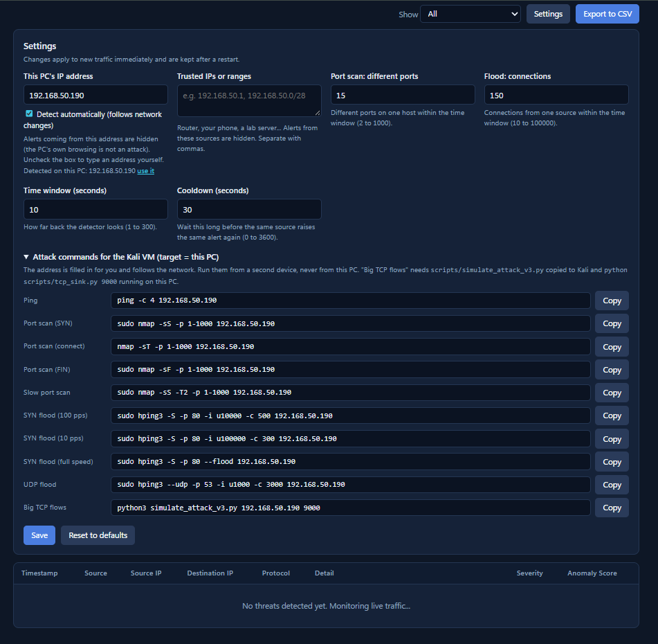

# Campus IDS — ICT30016 Innovation Project

A lightweight, lab-tested intrusion detection system for a campus-style network. Suricata captures traffic, four detection layers analyse it, and a Flask-SocketIO dashboard shows alerts in real time.

> Tested only in a controlled lab (Kali VM attacker, Windows target) and on CIC-IDS2017 as a benchmark. Not validated on a live campus network.



## Detection layers

| Layer | Colour | What it catches | Where |
|---|---|---|---|
| Rule | red | Known signatures (ping, SYN burst) | `suricata/rules/campus-ids.rules` |
| Stats | blue | Port scans and connection floods (per source IP, sliding window) | `dashboard/stats_detector.py` |
| ML | yellow | Flows with unusual size/volume (Isolation Forest, unsupervised) | `design1/model/` |
| RF | purple | Scan/flood-like behaviour of one source IP (Random Forest, supervised) | `design2/model/` |

## Two designs

| | Design 1 | Design 2 |
|---|---|---|
| Layers | Rule + Stats + ML | Rule + Stats + ML + **RF** |
| Start | `python dashboard/app.py` | `python dashboard/app.py --design2` |
| Details | [design1/README.md](design1/README.md) | [design2/README.md](design2/README.md) |

Design 2 is Design 1 plus one extra layer, so nothing Design 1 detects is lost.

| Design 1 result | Design 2 result |
|---|---|
|  |  |
| Rule, Stats and ML alerts | Same, plus purple Random Forest alerts |

## Setup

```powershell
python -m venv .venv
.venv\Scripts\Activate.ps1
pip install -r requirements.txt
```

1. Copy `suricata/rules/campus-ids.rules` into Suricata's rules folder, add it to `rule-files:` in `suricata.yaml`.
2. Start Suricata (Administrator PowerShell): `.\scripts\start_suricata.ps1`
3. Start the dashboard: `python dashboard/app.py` (or `--design2`), open http://127.0.0.1:5000

Useful options: `--eve <path>`, `--own-ip <IP>`, `--host 0.0.0.0`, `--port 5000`, `--model`, `--scaler`, `--rf-model`.

## Test with attacks

Open **Settings → Attack commands** in the dashboard. The target IP is filled in; copy each command and run it on the Kali VM (never against a machine you do not own). Setup: [docs/lab-setup.md](docs/lab-setup.md).



For "Big TCP flows", copy `scripts/simulate_attack_v3.py` to Kali and run `python scripts/tcp_sink.py 9000` on the target PC first.

## Train and evaluate

```powershell
python suricata/read_suricata_flows.py --input "C:\Program Files\Suricata\log\eve.json" --output data/suricata_flow_features.csv
python design1/model/train_model.py --input data/suricata_flow_features.csv --model_out design1/model/ids_model.joblib --scaler_out design1/model/ids_scaler.joblib
python evaluation/evaluate_cicids.py --input evaluation/Friday-WorkingHours-Afternoon-DDos.pcap_ISCX.csv evaluation/Friday-WorkingHours-Afternoon-PortScan.pcap_ISCX.csv --model design1/model/ids_model.joblib --scaler design1/model/ids_scaler.joblib --out evaluation/cicids_evaluation.csv
```

Train Design 1 on normal traffic only. Random Forest training and the Design 1 vs Design 2 comparison are described in [design2/README.md](design2/README.md).

## Settings

Own PC IP, trusted IPs, scan threshold (15 ports), flood threshold (150 connections), time window (10 s) and cooldown (30 s). Saved to `data/settings.json`; changeable only from the PC running the dashboard.

## Structure

```text
dashboard/    Flask app, detection layers, settings
suricata/     Rules and flow-feature extraction
design1/      Isolation Forest model + training script
design2/      Random Forest model
evaluation/   CIC-IDS2017 evaluation and comparison results
scripts/      Suricata start script, attack simulators
docs/  tests/  data/  assets/
```

## Known limits

- Isolation Forest looks at single flows, so it misses scans and floods (0% on CIC-IDS2017 DDoS/PortScan); Stats and RF cover those.
- RF was trained on our own Kali attacks; it can miss full-speed floods and UDP attacks, which Stats catches. Results are a first indication, not general accuracy.
- Alerts are not stored after the dashboard stops.

## Team

Jane Yan Zhen YU (Team Leader), Yan Han WONG, Neville Zi Yang, Bruce Gee Yick WONG
