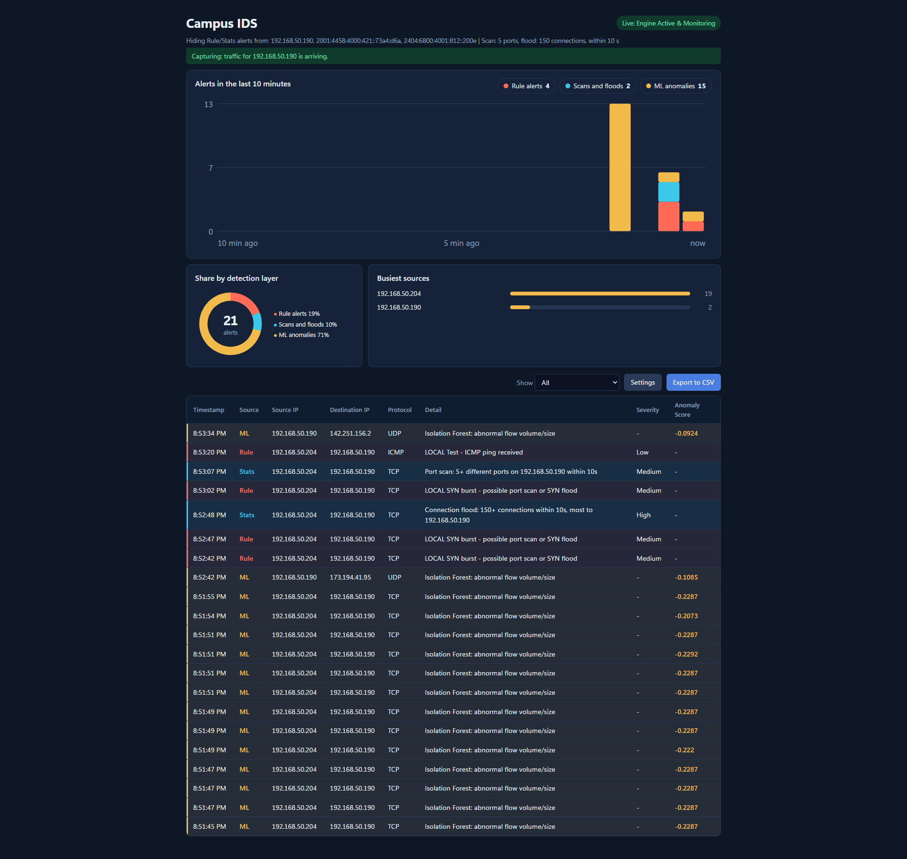
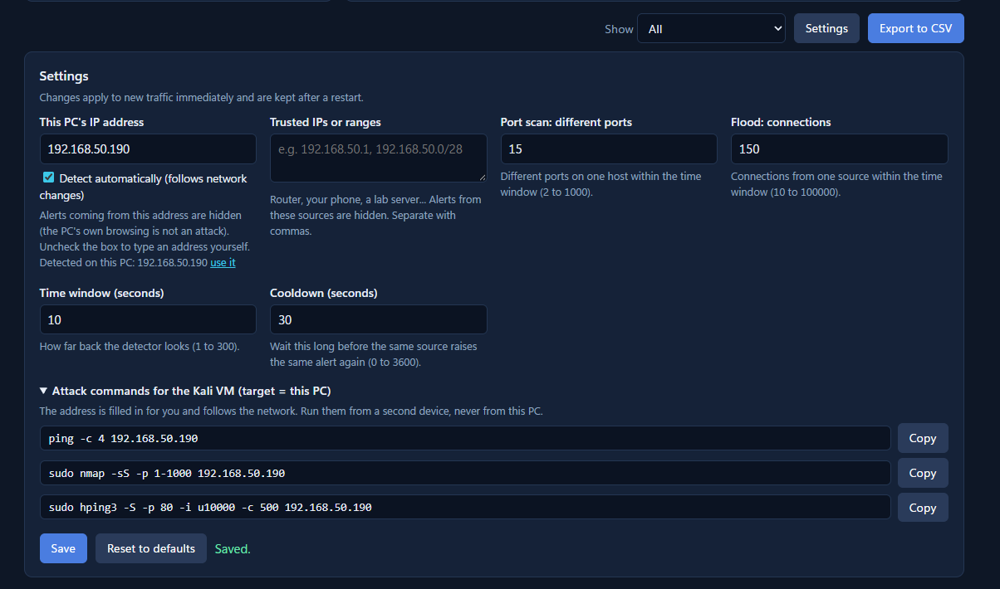

# Campus IDS - ICT30016 (ICT Innovation Project)

A lightweight Intrusion Detection System (IDS) for campus networks. It reads network traffic from Suricata and shows real-time alerts on a web dashboard. Alerts come from three detection layers working together.

## Dashboard

The dashboard is the main contribution of this project. It combines the three detection layers on one screen, draws live charts, and manages its own setup: it detects the PC's IP address automatically, follows the PC when it joins another network, and warns when Suricata is listening on the wrong network.



Open **http://127.0.0.1:5000** after starting the app.

Main dashboard features:
- **Status bar:** shows the hidden IP addresses, the current scan/flood thresholds, and the capture banner. A green banner means Suricata is delivering traffic for this PC.
- **Alerts in the last 10 minutes:** stacked bars in 30-second intervals. The legend shows how many alerts each layer raised.
- **Legend as filter:** click **Rule alerts**, **Scans and floods**, or **ML anomalies** to show only that layer in the table. Click again to show all.
- **Share by detection layer:** ring chart showing the proportion of Rule, Stats, and ML alerts.
- **Busiest sources:** the top source addresses and how many alerts they raised.
- **Alert table:** timestamp, layer, source IP, destination IP, protocol, detail, severity, and anomaly score.
- **Export to CSV:** saves the rows currently shown in the table.
- **Controls:** use the **Show** dropdown to filter, **Settings** to open the settings panel, and **Export to CSV** to download alerts.

## Settings Panel



The Settings panel changes behaviour immediately and saves the values to `data/settings.json`.

Settings panel features:
- **This PC's IP address:** alerts from this address are hidden, because the PC's own browsing is not an attack. *Detect automatically* follows network changes. Uncheck it to enter an address manually.
- **Trusted IPs or ranges:** hide alerts from other known devices, such as the router, your phone, or a lab server. Ranges like `192.168.50.0/28` are supported.
- **Port scan: different ports:** number of different ports on one host within the time window that counts as a port scan.
- **Flood: connections:** number of connections from one source within the time window that counts as a flood.
- **Time window (seconds):** how far back the Stats detector looks.
- **Cooldown (seconds):** how long to wait before the same source raises the same Stats alert again.
- **Attack commands for the Kali VM:** ready-to-copy `ping`, `nmap`, and `hping3` commands with the current target IP filled in. Run them from a second device, never from the PC that runs Suricata.
- **Save / Reset to defaults:** apply the new values or restore the default settings.

## Team Members

- **Jane Yan Zhen YU** (Team Leader)
- **Yan Han WONG**
- **Neville Zi Yang**
- **Bruce Gee Yick WONG**

## Architecture

```text
Network traffic -> Suricata -> eve.json -> Flask app (dashboard/app.py) -> live dashboard
                                              |- Rule layer   (Suricata signature alerts)
                                              |- Stats layer  (port scan / connection flood per source IP)
                                              '- ML layer     (Isolation Forest on flow features)
```

| Layer | Label | Detects | How |
|---|---|---|---|
| Rule | red **Rule** | Known patterns, e.g. ping, SYN bursts | Suricata rules in `suricata/rules/campus-ids.rules` |
| Stats | blue **Stats** | Port scan (15+ ports within 10 s), connection flood (150+ connections within 10 s) | `dashboard/stats_detector.py`, no training needed |
| ML | orange **ML** | Unusual flow size or volume | Isolation Forest trained on baseline traffic |

## Design Evolution

Version 1 used only an Isolation Forest. It had a low false-positive rate but detected **0% of DDoS and 0% of PortScan** in CIC-IDS2017 tests, because it looks at one flow at a time and misses many small, normal-looking flows.

Version 2 is a hybrid system. The Isolation Forest is kept for unknown flow anomalies, while a Suricata rule layer and a sliding-window stats layer catch known patterns, port scans, and floods.

## Results So Far

CIC-IDS2017 cross-dataset test (ML layer only):

| Test data | Result |
|---|---|
| BENIGN flows flagged (false positives) | 0.7% |
| DDoS detected | 0% |
| PortScan detected | 0% |

Lab test with a Kali VM attacking the target PC (one run per attack, preliminary):

| Attack | Rule layer | Stats layer | ML layer |
|---|---|---|---|
| Ping | detected | - | not detected |
| nmap SYN scan | detected | detected (Port scan) | not detected |
| hping3 SYN flood | detected | detected (Connection flood) | not detected |

Stats alerts appeared about 5-8 seconds after the first Rule alert.

**Known limitations**
- The ML layer alone does not detect scans or floods.
- The SYN-burst rule can fire on normal traffic from the monitored PC itself; its own address is hidden automatically.
- Thresholds are starting values and are not tuned on a large dataset.
- Alerts are not stored; charts and table start empty on each page load.
- Suricata must be restarted when the PC joins another network.
- Testing is done only in our own lab.

## Prerequisites

1. **Python 3**, a recent version. `requirements.txt` pins `scikit-learn==1.9.0`.
2. **Suricata (Windows)** with **Npcap** in WinPcap API-compatible mode.
3. **Suricata configuration**: `eve-log` must log both `flow` and `alert` events, and `campus-ids.rules` must be listed under `rule-files:`.
4. **Kali Linux VM** in VMware with the network adapter set to **Bridged** for attack testing.

## Installation

```bash
pip install -r requirements.txt
```

## Execution Workflow

### Step 1: Set up the rules (first time only)

Copy `suricata/rules/campus-ids.rules` to `C:\Program Files\Suricata\rules\`, add it to `rule-files:` in `suricata.yaml`, then test the config in an Administrator terminal:

```powershell
cd "C:\Program Files\Suricata"
.\suricata.exe -T -c suricata.yaml
```

### Step 2: Start Suricata

Open an Administrator PowerShell in the project folder:

```powershell
.\scripts\start_suricata.ps1
```

Suricata writes events to `C:\Program Files\Suricata\log\eve.json`.

### Step 3: Train the ML model (first time only)

```powershell
python suricata/read_suricata_flows.py --input "C:\Program Files\Suricata\log\eve.json" --output data/suricata_flow_features.csv
python model/train_model.py --input data/suricata_flow_features.csv --model_out model/ids_model.joblib --scaler_out model/ids_scaler.joblib
```

### Step 4: Launch the dashboard

```powershell
python dashboard/app.py
```

Open **http://127.0.0.1:5000**. The capture check banner should turn green once Suricata delivers traffic.

### Step 5: Run attack tests from the Kali VM

Run these from the Kali VM, not from the PC running Suricata:

```bash
ping -c 4 <TARGET_IP>
sudo nmap -sS -p 1-1000 <TARGET_IP>
sudo hping3 -S -p 80 -i u10000 -c 500 <TARGET_IP>
```

### Step 6: Cross-dataset evaluation (ML layer)

```powershell
python evaluation/evaluate_cicids.py --input evaluation/Friday-WorkingHours-Afternoon-DDos.pcap_ISCX.csv evaluation/Friday-WorkingHours-Afternoon-PortScan.pcap_ISCX.csv --model model/ids_model.joblib --scaler model/ids_scaler.joblib --out evaluation/cicids_evaluation.csv
```

## When the PC Joins Another Network

1. The dashboard follows the new address within about 5 seconds.
2. Stop Suricata with `Ctrl + C` and run `.\scripts\start_suricata.ps1` again.
3. On the Kali VM, get a new address in the new network before running attacks.

## Settings Quick Reference

| Setting | Meaning | Default |
|---|---|---|
| This PC's IP address | Rule and Stats alerts from it are hidden. *Detect automatically* is on by default | detected |
| Trusted IPs or ranges | Other sources to hide, e.g. router or phone | none |
| Port scan: different ports | Different ports on one host within the window that count as a port scan | 15 |
| Flood: connections | Connections from one source within the window that count as a flood | 150 |
| Time window | Look-back window in seconds | 10 |
| Cooldown | Seconds before the same source raises the same Stats alert again | 30 |

## Tests

```bash
python tests/test_settings.py
```

Unit tests for settings validation, IP matching, live setting changes, automatic IP, capture check, and the settings web API.

## Project Layout

```text
dashboard/        Flask app, detection layers, settings, web page
suricata/         Suricata rules and eve.json flow feature extraction
model/            Isolation Forest training script and saved model/scaler
evaluation/       CIC-IDS2017 evaluation script and results
scripts/          start_suricata.ps1, replay_demo.py, attack simulation scripts
docs/             lab-setup.md, suricata-config.md, dashboard-settings.md
tests/            unit tests
data/             baseline flow features
```

## Safe Shutdown

1. **Dashboard:** press `Ctrl + C` in the terminal running `app.py`.
2. **Suricata:** press `Ctrl + C` in the Administrator terminal and wait until it prints `Engine shut down`.

## Troubleshooting

- **Permission denied:** run PowerShell as Administrator.
- **"no rules were loaded":** keep every rule on one line and save as plain text, e.g. with `Set-Content -Encoding ascii`.
- **Banner says "none involve this PC":** Suricata listens on another network. Restart it with `.\scripts\start_suricata.ps1`.
- **No alerts from attacks:** ensure Kali is in **Bridged** mode, the target is the real LAN IP, and loopback `127.0.0.1` is not used.
- **Settings cannot be saved:** settings can only be changed from a browser on the PC running the dashboard.