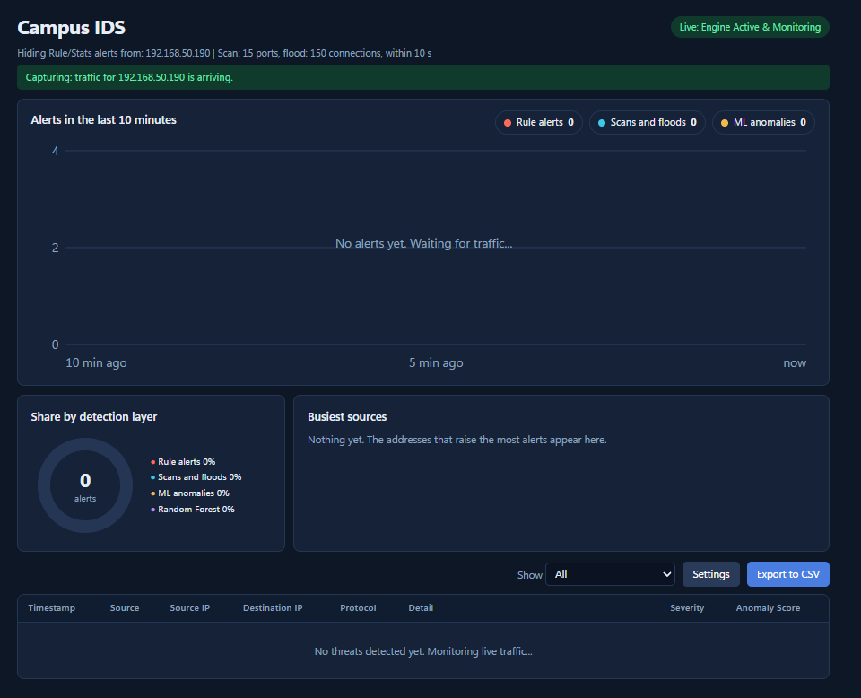
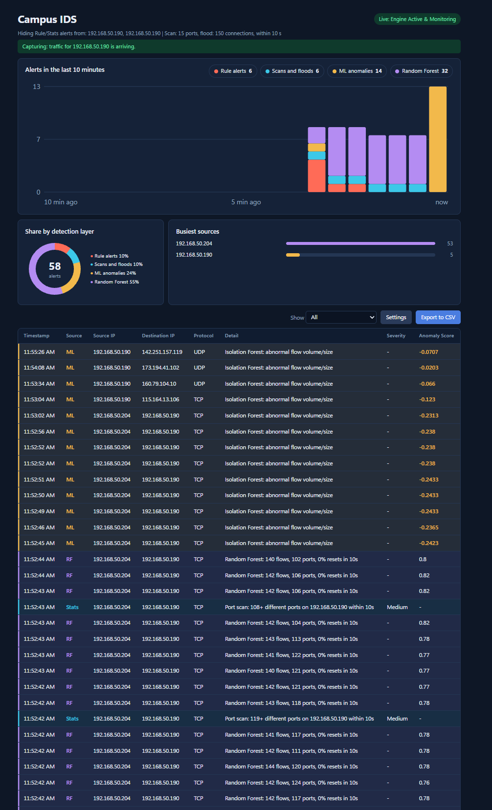
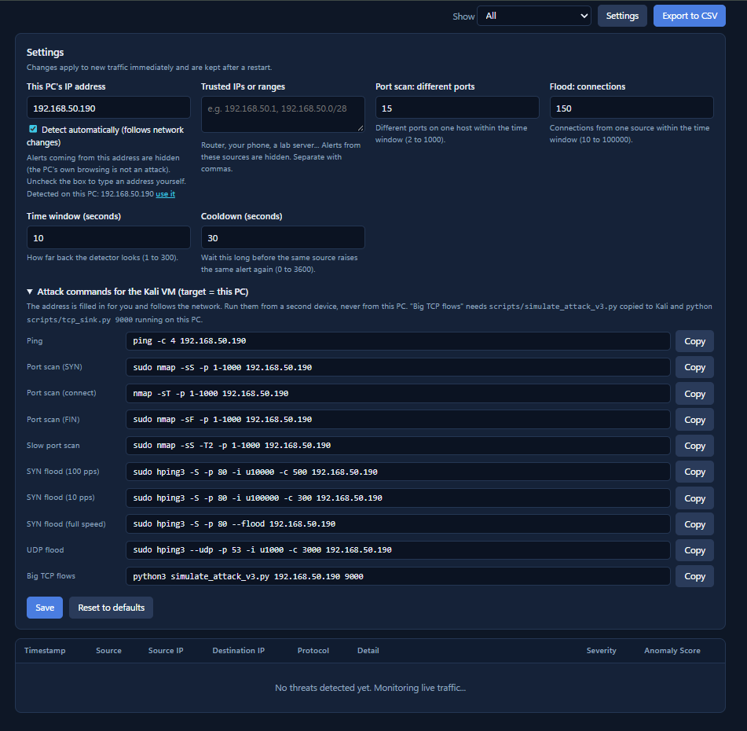

# Campus IDS — ICT30016 Innovation Project

A lightweight, lab-tested intrusion detection system for a campus-style network. Suricata captures traffic, four detection layers analyse it, and a Flask-SocketIO dashboard shows alerts in real time.

> Tested only in a controlled lab (Kali VM attacker, Windows target) and on CIC-IDS2017 as a benchmark. Not validated on a live campus network.

## Team

| Member | Area | Contributions |
|---|---|---|
| **Jane Yan Zhen YU** (Team Leader) | Architecture, rules, QA, management | Dual-track architecture and threat model; Layer 1 rules (ICMP, SYN flood); baseline profiling and false-alarm criteria; D5 QA test plan and regression checks; compiled and submitted the Specification report; Week 8 decision-gate metrics; Stand up 2 |
| **Yan Han WONG** | Set-up, capture, Stats, windows | GitHub repo, branching, `design1/` and `design2/` layout; Suricata and Npcap set-up, `start_suricata.ps1`; live `eve.json` reader with offset tracking; joint feature mapping with Bruce; `aggregate.py` (10 s per-IP windows); `stats_detector.py` and IP whitelist; Kali attacks with Bruce; demo video |
| **Bruce Gee Yick WONG** | ML and evaluation | Layer 3 Isolation Forest and contamination tuning; Layer 4 Random Forest training, class weights, depth tuning; CIC-IDS2017 evaluation pipeline and confusion matrices; joint feature mapping and Kali attacks |
| **Neville Zi Yang** | Dashboard | Wireframes, responsive CSS, theme; Flask-SocketIO backend and alert routing; four-layer alert grid, filters, settings panel; CSV export and forensic logging |

> **Note on Commit History:** As our team was learning Git/GitHub workflows during this project and our capture/testing setup ran on a single host machine, most integration, debugging, and commits were carried out collaboratively in face-to-face sessions and pushed from one local environment. Therefore, GitHub commit authorship does not reflect individual workload or code ownership—please refer to the contribution table above for each member's actual responsibilities.


## Detection layers
| Layer | Colour | What it catches | Where |
|---|---|---|---|
| Rule | red | Known signatures (ping, SYN burst) | `suricata/rules/campus-ids.rules` |
| Stats | blue | Port scans and connection floods (per source IP, sliding window) | `dashboard/stats_detector.py` |
| ML | yellow | Flows with unusual size/volume (Isolation Forest, unsupervised) | `design1/model/` |
| RF | purple | Scan/flood-like behaviour of one source IP (Random Forest, supervised) | `design2/model/` |

## Two designs

| | Design 1 | Design 2 |
|---|---|---|
| Layers | Rule + Stats + ML | Rule + Stats + ML + **RF** |
| Start | `python dashboard/app.py` | `python dashboard/app.py --design2` |
| Details | [design1/README.md](design1/README.md) | [design2/README.md](design2/README.md) |

Design 2 is Design 1 plus one extra layer, so nothing Design 1 detects is lost.

| Design 1 result | Design 2 result |
|---|---|
|  |  |
| Rule, Stats and ML alerts | Same, plus purple Random Forest alerts |

## Requirements

The tool runs on **Windows** (the start script is PowerShell and Suricata needs Administrator rights).

| Needed | Why |
|---|---|
| Windows 10/11 | Runs Suricata, the dashboard and the browser |
| [Suricata](https://suricata.io/download/) for Windows (installs to `C:\Program Files\Suricata`) | Captures traffic and writes `eve.json` |
| [Npcap](https://npcap.com/) | Packet capture driver used by Suricata |
| Python 3 (add the version you tested with) and `pip` | Dashboard and ML models |
| Administrator PowerShell | Needed to start Suricata |
| Kali Linux VM, network adapter set to **Bridged** (optional) | Only to run the attack tests; see [docs/lab-setup.md](docs/lab-setup.md) |

Without Suricata or Kali you can still check the code with `python tests/test_settings.py` (the API tests need Flask only).

## Setup

**1. Clone and install**

```powershell
git clone https://github.com/wyhannnnn423/ICT30016-ICT-Innovation-Project.git
cd ICT30016-ICT-Innovation-Project\campus-ids
python -m venv .venv
.venv\Scripts\Activate.ps1
pip install -r requirements.txt
```

**2. Add our rules to Suricata**

1. Copy `suricata/rules/campus-ids.rules` into `C:\Program Files\Suricata\rules\`.
2. In `suricata.yaml`, add `- campus-ids.rules` under `rule-files:` and make sure `alert` is listed under the `eve-log` types.
3. Test the config in an Administrator terminal: `suricata.exe -T -c suricata.yaml`. It should report the rules loaded with 0 failed.

Save the rules file as plain text; a wrong encoding once made Suricata load 0 rules.

**3. Start Suricata** (Administrator PowerShell)

```powershell
.\scripts\start_suricata.ps1
```

The script finds the network adapter that carries the default route and starts Suricata on it. If the PC later joins another network, stop Suricata with Ctrl+C and run the script again. Details: [docs/dashboard-settings.md](docs/dashboard-settings.md).

**4. Start the dashboard**

```powershell
python dashboard/app.py            # Design 1
python dashboard/app.py --design2  # Design 2 (adds the Random Forest layer)
```

Open http://127.0.0.1:5000. Nothing needs to be configured: the IP of this PC is detected automatically and its own traffic is not reported. A banner under the summary line turns green when traffic of this PC arrives.

Useful options: `--eve <path>`, `--own-ip <IP>`, `--host 0.0.0.0`, `--port 5000`, `--model`, `--scaler`, `--rf-model`.

**Trained models.** The dashboard loads the models from `design1/model/` and `design2/model/`. If those `.joblib` files are missing after cloning, create them first with the commands in [Train and evaluate](#train-and-evaluate).

## Test with attacks

Open **Settings → Attack commands** in the dashboard. The target IP is filled in; copy each command and run it on the Kali VM (never against a machine you do not own). Lab setup and expected results: [docs/lab-setup.md](docs/lab-setup.md).



For "Big TCP flows", copy `scripts/simulate_attack_v3.py` to Kali and run `python scripts/tcp_sink.py 9000` on the target PC first.

## Train and evaluate

```powershell
python suricata/read_suricata_flows.py --input "C:\Program Files\Suricata\log\eve.json" --output data/suricata_flow_features.csv
python design1/model/train_model.py --input data/suricata_flow_features.csv --model_out design1/model/ids_model.joblib --scaler_out design1/model/ids_scaler.joblib
python evaluation/evaluate_cicids.py --input evaluation/Friday-WorkingHours-Afternoon-DDos.pcap_ISCX.csv evaluation/Friday-WorkingHours-Afternoon-PortScan.pcap_ISCX.csv --model design1/model/ids_model.joblib --scaler design1/model/ids_scaler.joblib --out evaluation/cicids_evaluation.csv
```

Train Design 1 on normal traffic only. Random Forest training and the Design 1 vs Design 2 comparison are described in [design2/README.md](design2/README.md).

## Settings

Own PC IP, trusted IPs, scan threshold (15 ports), flood threshold (150 connections), time window (10 s) and cooldown (30 s). Saved to `data/settings.json`; changeable only from the PC running the dashboard. Full description: [docs/dashboard-settings.md](docs/dashboard-settings.md).

## Structure

```text
dashboard/    Flask app, detection layers, settings
suricata/     Rules and flow-feature extraction
design1/      Isolation Forest model + training script
design2/      Random Forest model
evaluation/   CIC-IDS2017 evaluation and comparison results
scripts/      Suricata start script, attack simulators
docs/  tests/  data/  assets/
```

## Documentation

- [docs/lab-setup.md](docs/lab-setup.md): machines, one-time setup, attack commands, first test run
- [docs/dashboard-settings.md](docs/dashboard-settings.md): Settings panel, capture banner, automatic network handling
- [design1/README.md](design1/README.md) and [design2/README.md](design2/README.md): models and training

## Known limits

- Isolation Forest looks at single flows, so it misses scans and floods (0% on CIC-IDS2017 DDoS/PortScan); Stats and RF cover those.
- RF was trained on our own Kali attacks; it can miss full-speed floods and UDP attacks, which Stats catches. Results are a first indication, not general accuracy.
- Alerts are not stored after the dashboard stops.
