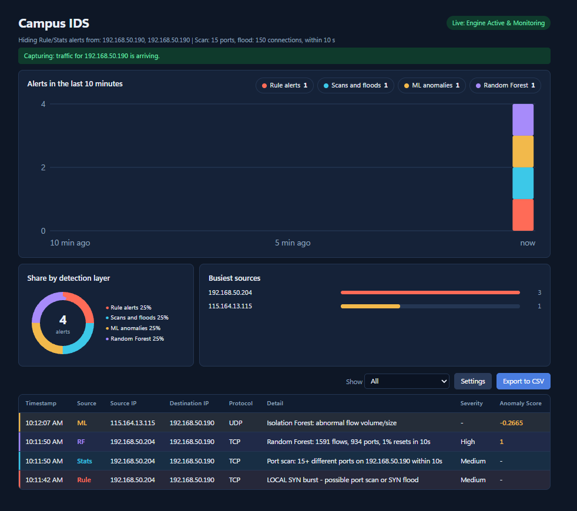

# Design 2: Random Forest on 10-second IP windows

Design 1 looks at one network flow at a time. A port scan or a SYN flood is made of many tiny flows, so
it is hard to see that way. Design 2 looks at **one source IP over 10 seconds** and a Random Forest
decides "attack or normal". It is an optional extra layer on top of Design 1: without `--rf` the dashboard
works exactly as before.

> Status: early prototype. It was trained and tested only on our own lab attacks (Kali VM and one other
> device, port scans and SYN floods), so the numbers below are a first indication, not a final test.

## How it works

1. Suricata writes flow records to `eve.json`.
2. Flows are grouped by source IP and by 10-second window (by when the flow started).
3. For each (IP, window) we compute 5 features:

| Feature | Meaning |
|---|---|
| `conn_count` | number of flows the IP started in the window |
| `distinct_ports` | number of different destination ports it touched |
| `rst_ratio` | share of TCP flows that ended with a reset |
| `avg_pkts` | average packets per flow |
| `total_bytes` | bytes sent and received in all those flows |

4. A Random Forest (scikit-learn, 200 trees, class-weighted) says attack or normal.
   It is a two-class model: port scans and floods are both just "attack".

`syn_ratio` was in our first plan but is no longer used: every flow of our hping3 flood has 6 packets
(SYN, RST, ACK), so the SYN ratio stayed close to zero and the model ignored it.

## Files

| File | What it does |
|---|---|
| `aggregate.py` | Turns `eve.json` into one row per (source IP, 10 s window). With `--labels` it also labels the windows. Also holds `parse_flow_event`, which the live detector reuses, so training and live detection use the same numbers. |
| `train_rf.py` | Trains the Random Forest and tests it with leave-one-day-out cross-validation. Saves `model/rf_model.joblib` and a report in `evaluation/results_rf.txt`. |
| `labels.csv`, `labels_oct13.csv` | Our attack logs (start time, end time, attacker IP, label). |
| `attack_logger.sh` | Runs on the Kali VM. Runs one attack and writes its label line for you. |
| `peek_flows.py` | Prints a few raw flow records, to see what an attack really looks like. |
| `cicids_check.py` | Tries the model on CIC-IDS2017 (needs the TrafficLabelling version of the files, see Limits). |
| `../dashboard/rf_detector.py` | The live version, used by the dashboard. |
| `../evaluation/compare_designs.py` | Design 1 vs Design 2 table on the same windows. |
| `../tests/test_rf_detector.py` | Tests for the live detector. |

## Run it live (quick start)

You need `model/rf_model.joblib`. It is not in Git (`.gitignore` skips `*.joblib`), so make it first:

```
python design2/train_rf.py --input data/windows_labelled.csv
```

Then start the dashboard with the extra layer:

```
python dashboard/app.py --rf
```

- The terminal should say `RF = on`. If it says `RF = OFF (...)`, the text in the brackets is the reason.
- RF alerts show in the dashboard as the purple **Random Forest** source, with the attack probability in the score column.
- Add `--rf-debug` to see the probability of every 10-second window that has 2 or more flows. This is the easiest way to see why RF is quiet.
- `--rf-model <path>` uses another model file.

What it looks like: an `nmap -sS -p 1-1000` scan from Kali (192.168.50.204) against the PC running Suricata.
The Rule alert comes first, then Stats and Random Forest (the RF time is the end of its 10-second window). The ML row at the top is
a separate, unrelated alert for normal UDP traffic.



Things to know:

- An RF alert comes **about 15 seconds after the attack**: the 10-second window has to end, and the detector
  waits 5 seconds for late flow records. Rule and Stats alerts are still instant.
- An IP needs at least 5 flows in a window before RF can alert on it (`min_flows`), and the same IP raises
  one RF alert at most every 30 seconds (`cooldown`). Other settings: attack probability must reach 0.5.
  These are arguments of `RFDetector` in `dashboard/rf_detector.py`.
- Hidden IPs (own PC, trusted IPs in the Settings panel) are skipped by RF too.

## Make new training data

Do the attacks from the Kali VM, one by one, with `attack_logger.sh`, so every attack gets an exact label.

On the Kali VM (target = the IP of the PC running Suricata, here 192.168.50.190; Kali itself is 192.168.50.204):

```
chmod +x attack_logger.sh                 # once
TZ=Asia/Kuala_Lumpur date                 # check Kali's clock is right
./attack_logger.sh portscan 192.168.50.204 sudo nmap -sS -p 1-1000 192.168.50.190
./attack_logger.sh synflood 192.168.50.204 sudo hping3 -S -p 80 -i u5000 -c 500 192.168.50.190
```

Each run prints one line (start, end, attacker IP, label) and adds it to `attack_log.csv`.
Copy these lines to the end of `design2/labels.csv` on the Windows PC. If the Kali clock is wrong, the labels are wrong.

Then build the labelled windows and train again. `<eve.json files>` are all the files that contain your attacks
(for us `C:\Program Files\Suricata\log\eve.json`; copy it to a safe place after every test session, because the
file can be cleared):

```
python design2/aggregate.py --eve <eve.json files> --labels design2/labels.csv design2/labels_oct13.csv --attacker-ips 192.168.50.204 192.168.50.72 --out data/windows_labelled.csv
python design2/train_rf.py --input data/windows_labelled.csv
```

- A window is labelled as an attack if it comes from the attacker IP, overlaps an attack time, and has at least 5 flows.
- Windows from an attacker machine outside every attack time are "ambiguous" and left out.
- Everything else is "benign".
- If train_rf.py says the attack runs come from fewer than 2 days, the cross-validation cannot run.

Add `--ignore-ips 192.168.50.190` to `train_rf.py` to leave out your own PC when you check the results.

## Results so far

Same windows for every method: 20,685 windows from the 5 days with attacks (our own PC left out), of which 96 are
attack windows (port scans of 7 kinds, SYN floods of 7 speeds, one UDP scan, one UDP flood). Random Forest is tested with
leave-one-day-out cross-validation: every window is predicted by a model that never saw that day. The Design 1 layers need
no training on attacks; they were replayed from the real `eve.json` through `dashboard/detection.py`.

| Method | Attacks found | False-alarm windows | Precision | Recall | F1 |
|---|---|---|---|---|---|
| Design 1 Isolation Forest layer | 0 of 96 | 298 | 0.00 | 0.00 | 0.00 |
| Design 1 Suricata rule layer | 82 of 96 | 310 | 0.21 | 0.85 | 0.34 |
| Design 1 Stats layer | 90 of 96 | 6 | 0.94 | 0.94 | 0.94 |
| Design 1 all layers together | 95 of 96 | 601 | 0.14 | 0.99 | 0.24 |
| **Design 2 Random Forest** | 86 of 96 | 1 | 0.99 | 0.90 | 0.94 |

What this means:

- Design 2 is much better than the Isolation Forest layer, which found none of our attacks.
- Design 2 and the Stats layer end up equal overall (F1 0.94 both), but they miss **different** attacks:
  - The Stats layer missed all 3 windows of the slowest SYN flood (10 packets per second); the Random Forest found 2 of them.
  - The Random Forest missed the full-speed `hping3 --flood` runs (0 of 5 windows) and the UDP flood and UDP scan (0 of 1 each);
    the Stats layer found all of them.
- The Random Forest has the fewest false alarms (1 window). The rule layer and the Isolation Forest raise hundreds on normal traffic.
- So Design 2 looks more useful as a second layer next to Stats than as a replacement for it.
- Only 96 attack windows from a few runs (some attack kinds have 1 to 3 windows), so treat small differences as noise. The Stats limits
  were chosen while looking at part of these data, so none of the numbers is a final, independent test.
- No ICMP flood window appears: an ICMP flood is only a handful of flows (no ports), so its windows have fewer than 5 flows and are left out.

Live tests from Kali against the Windows PC:

- `nmap -sS -p 1-1000`: RF alert with 1591 flows, 934 ports, attack probability 1.0.
- `hping3 -S -p 80 --flood`: RF alert with 20310 flows, but only probability 0.70, so the model is less sure about floods.

Reproduce the table (takes a few minutes on a 5 GB `eve.json`):

```
python evaluation/compare_designs.py --eve <eve.json files> --ignore-ips 192.168.50.190
```

The Design 1 rows are only real when `--eve` points to the files that contain the attacks. The rows that apply the two limits
to the fixed windows (without `--eve` they are the only Design 1 rows) over-count ports, so use the "live replay" row.

## Limits

- Very slow attacks are missed: a SYN flood of 10 packets per second was missed by the Stats layer (0 of 3 windows) and found by the Random Forest in 2 of 3.
- Little attack data: one Kali VM, one other device, two attack types. The model may not work on other tools or speeds.
- The Random Forest missed all full-speed `hping3 --flood` windows on the held-out day (0 of 5) and had low confidence (0.70) in the live flood test. It also missed the UDP attacks, which it has never seen in training.
- About 15 seconds of delay for RF alerts.
- CIC-IDS2017: the Friday files in `evaluation/` have no Source IP and no Timestamp, so no per-IP windows can be built.
  `cicids_check.py` needs the TrafficLabelling version. CIC also counts bytes differently from Suricata, so train without
  `total_bytes` for that check (command in the file's header).
- The Stats limits and the model features were chosen while looking at part of this data, so none of the numbers is a final, independent test.

## Troubleshooting

| Problem | What to do |
|---|---|
| `RF = OFF (...)` at start | Read the text in the brackets. Usually the model file is missing: run `train_rf.py`. |
| Model was trained with another scikit-learn version | Run `train_rf.py` again on your own computer. |
| RF shows no alert during an attack | Wait 20 seconds, then run with `--rf-debug` and look at `p(attack)`. |
| `[RF debug] ... (fewer than min_flows: never alerts)` | That IP had fewer than 5 flows in the window. Normal for quiet traffic. |
| Labels do not match the attacks | Check Kali's clock and that `--attacker-ips` lists every machine used for attacks. |

## Tests

```
python tests/test_rf_detector.py
```
